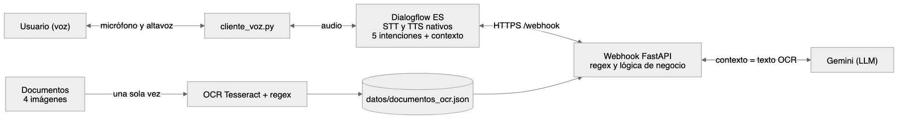

# FitZone: asistente de voz para un gimnasio

## Caso de uso

FitZone es un gimnasio cuyo asistente atiende por voz. El socio habla y el agente responde hablando. Puede **reservar una clase dirigida** (yoga, pilates, spinning, crossfit, zumba o boxeo) en una conversación de varios turnos: el agente pide clase, día, hora y código de socio, valida el código con una expresión regular, comprueba plan, horario y plazas, y termina pidiendo confirmación (sí/no). También permite **consultar una reserva** por su código y **responder preguntas sobre la documentación del gimnasio** (normativa, tarifas, horario de clases y plan de entrenamiento), que se procesó una vez con OCR. Si la respuesta no está en los documentos, el asistente lo dice en lugar de inventarla.

## Arquitectura



| Pieza | Fichero |
| --- | --- |
| Agente Dialogflow ES (export) | `agente/fitzone-agente.zip` (se genera con `construir_agente.py`) |
| Webhook FastAPI | `main.py` |
| Datos de negocio simulados | `negocio.py` |
| OCR + regex (offline, una vez) | `ocr.py` → `datos/documentos_ocr.json` |
| Documentos de entrada | `documentos/*.png` (los crea `generar_documentos.py`) |
| Cliente de voz | `cliente_voz.py` |
| Pruebas | `tests/test_webhook.py` |

## Intenciones

Cinco significativas, más bienvenida y fallback. Un único contexto, `ctx_reserva_en_curso`.

| Intención | Propósito | Webhook |
| --- | --- | --- |
| `Default Welcome Intent` | Saludo (con SSML) | no |
| `reservar_clase` | Inicia el flujo. Parámetros obligatorios: `clase`, `fecha`, `hora`, `codigo_socio`. Activa el contexto | sí |
| `reservar_clase - yes` | Follow-up: confirma y crea la reserva (devuelve `RES-xxxxxx`) | sí |
| `reservar_clase - no` | Follow-up: cancela sin reservar | no |
| `consultar_reserva` | Busca una reserva por `codigo_reserva` | sí |
| `consulta_documental` | Pregunta sobre normas, tarifas, horarios o entrenamiento (LLM + OCR) | sí |
| `Default Fallback Intent` | Lo que no encaja se intenta responder con los documentos; si no, "no dispongo de ese dato" | sí |

**Entidades:** `clase_gimnasio` (personalizada, con sinónimos), `codigo_socio` y `codigo_reserva` (regex), `@sys.date` y `@sys.time` (de sistema).

## Decisiones técnicas

- **Regex en dos niveles.** Las entidades regex de Dialogflow son laxas a propósito (`(?:SOC[\s-]?)?[0-9]{4,6}`): el reconocimiento de voz transcribe el código de formas distintas. El webhook lo normaliza (`soc 10234`, `10234` → `SOC-10234`) y aplica la regex estricta `^SOC-\d{5}$` (y `^RES-\d{6}$` para reservas). Un código de 4 o 6 dígitos pasa la entidad pero el webhook lo rechaza.
- **Respuesta que depende de los datos.** El webhook comprueba que el socio exista, esté al corriente de pago y tenga un plan con clases (el Básico no), que la fecha no sea pasada ni supere 14 días, que esa clase se imparta ese día a esa hora y que queden plazas. Cada fallo tiene su mensaje.
- **Un error cierra el flujo.** Si la validación falla, el webhook devuelve los contextos con lifespan 0. Así un "sí" posterior no puede confirmar una reserva rechazada, y el usuario empieza de nuevo.
- **Los datos validados viajan en el contexto** (`r_clase`, `r_fecha`, `r_hora`, `r_socio`), de modo que el "sí" crea exactamente lo que se mostró al usuario.
- **Voz.** STT y TTS nativos de Dialogflow (modo audio de `detect_intent`). Las respuestas del webhook son SSML: pausas con `<break>` y los códigos se leen dígito a dígito con `<say-as interpret-as="digits">`. Todo el texto dinámico se escapa para que no rompa el XML. El cliente pide una voz neuronal (`es-ES-Neural2-A`, configurable con `VOZ_TTS`) y, si no existe, reintenta con la voz por defecto. Cada turno imprime su latencia y avisa si supera 5 s.
- **OCR (`ocr.py`).** Tesseract con idioma `spa`. Preprocesado: escala de grises y autocontraste, enderezar el giro del escaneo (se prueba de -2° a 2°), ampliar x2, binarizar y **borrar las rayas de las tablas**. Sin borrar las rayas, Tesseract las lee como `|` y `[` y pierde filas enteras de las tablas. El umbral de binarización (160) se eligió probando valores sobre el horario: con 160 salen las 14 filas esperadas, con 180 solo 5.
- **Errores de OCR.** No se corrige el texto a ciegas (reemplazar `O` por `0` estropea las palabras). Cada documento se valida con regex: debe leerse su referencia (`FZ-XXX-AAAA-NN`) y las fechas deben ser válidas; si no, se marca `REVISAR`. Se extraen también importes, horas y teléfonos. Error conocido que queda: en `plan_entrenamiento.png` la sentadilla se lee como `3x2` en vez de `3x12`, y el asistente repetiría ese dato.
- **Contexto en el prompt, sin base vectorial.** Son 4 documentos, así que el texto completo va al prompt. Se descartó la Knowledge Base de Dialogflow porque el modelo, la plantilla y el control de respuestas quedan bajo nuestro código.
- **Control de alucinaciones, en tres capas.**
  1. El prompt obliga a responder solo con los documentos.
  2. La salida es JSON (`respondible`, `respuesta`, `cita`). Si `respondible` es falso, se responde con un mensaje fijo: "No dispongo de ese dato en la documentación del gimnasio".
  3. Si es verdadero, el webhook comprueba que la `cita` del modelo existe en los documentos (coincidencia por palabras y en orden, ≥ 80 %). Tolera el ruido del OCR pero rechaza citas inventadas.
- **Si el modelo tarda o falla.** `asyncio.wait_for` corta a los 3,5 s y cualquier excepción devuelve un mensaje de disculpa: Dialogflow corta a los 5 s y un webhook que lanza una excepción deja al usuario en silencio. En las pruebas, Gemini responde en torno a 1 s (`thinking_budget=0`).
- **Documentos sintéticos.** Las cuatro imágenes las dibuja `generar_documentos.py` con un giro y ruido para simular un escaneo. El horario sale de `negocio.py`, la misma fuente de datos que usa el webhook, así que documento y lógica no se contradicen.
- **Datos simulados.** Socios, plazas y reservas viven en memoria (`negocio.py`, `main.py`): se pierden al reiniciar.

## Cómo ejecutarlo

Requisitos: Python 3.12+, Tesseract (`brew install tesseract`), ngrok, un proyecto de Google Cloud con Dialogflow API y una cuenta de servicio con rol *Dialogflow API Client*.

```bash
python3 -m venv .venv && source .venv/bin/activate
pip install -r requirements.txt
```

`.env` (ya está en el `.gitignore`, igual que la clave JSON):

```
GOOGLE_APPLICATION_CREDENTIALS=clave-dialogflow.json
DIALOGFLOW_PROJECT_ID=<id del proyecto>
GOOGLE_API_KEY=<clave de Gemini>
```

`tessdata/spa.traineddata` es el idioma español de Tesseract (viene incluido; si falta, descárgalo de `tessdata_fast`).

1. **OCR (una sola vez):**
   ```bash
   python generar_documentos.py   # solo si quieres regenerar las imágenes
   python ocr.py                  # crea datos/documentos_ocr.json
   ```
2. **Webhook:**
   ```bash
   uvicorn main:app --port 8000
   ngrok http 8000                # copia la URL https://xxxx.ngrok-free.app
   ```
   Comprueba el túnel abriendo esa URL: debe devolver `{"estado":"ok","documentos_cargados":4}`.
3. **Agente** (si prefieres montarlo a mano en la consola, sigue [MANUAL_DIALOGFLOW.md](MANUAL_DIALOGFLOW.md)):
   ```bash
   python construir_agente.py https://xxxx.ngrok-free.app/webhook
   ```
   En la consola de Dialogflow ES: crea un agente nuevo en español → ⚙ → *Export and Import* → *Restore from ZIP* → `agente/fitzone-agente.zip`. **Restore sustituye todo el agente**, así que no lo hagas sobre uno que quieras conservar. Después, en *Training*, comprueba que está entrenado.
4. **Voz:**
   ```bash
   python cliente_voz.py
   ```
   Enter para hablar (6 s de grabación); el agente saluda primero.
5. **Pruebas:** `pytest -v` (18 pruebas del webhook; las 4 últimas llaman a Gemini de verdad).

## Datos para la demo

| Socio | Resultado |
| --- | --- |
| `SOC-10234` Enmanuel Alejandro (Premium) | puede reservar |
| `SOC-20871` Javier Núñez (Básico) | "tu plan no incluye clases" |
| `SOC-30455` Lucía Ferrer (Plus, impagado) | "pago pendiente" |

Reserva de ejemplo: `RES-482913`. Sesiones completas: spinning del viernes 07:30 y boxeo del jueves 20:30.

**Guion de 3 minutos:**
1. "Hola" → saludo.
2. "Quiero reservar una clase de yoga" → "¿para qué día?" → "el lunes" → "¿a qué hora?" → "a las 7 de la tarde" → "¿cuál es tu código de socio?" → "SOC 10234".
3. El agente resume la reserva y pide confirmación → "sí" → da el código `RES-…`.
4. "Consulta la reserva RES 482913" → datos de la reserva.
5. "¿Hay que llevar toalla?" y "¿Cuánto cuesta el plan Premium?" → respuestas sacadas de los documentos.
6. "¿Cuánto cuesta un entrenador personal?" → "No dispongo de ese dato…".

## Límites conocidos

- El flujo de reserva no admite corregir un dato a mitad: si hay un error, se vuelve a empezar.
- Un código de socio dictado dígito a dígito por el reconocedor ("1 0 2 3 4") puede no encajar en la entidad regex. Lo más fiable es decirlo seguido, por ejemplo "SOC 10234".
- El export del agente se ha generado copiando el formato del export de clase y todos sus JSON son válidos, pero no se ha importado en una consola real de Dialogflow desde aquí. El webhook está probado con peticiones simuladas de Dialogflow y con Gemini real.
